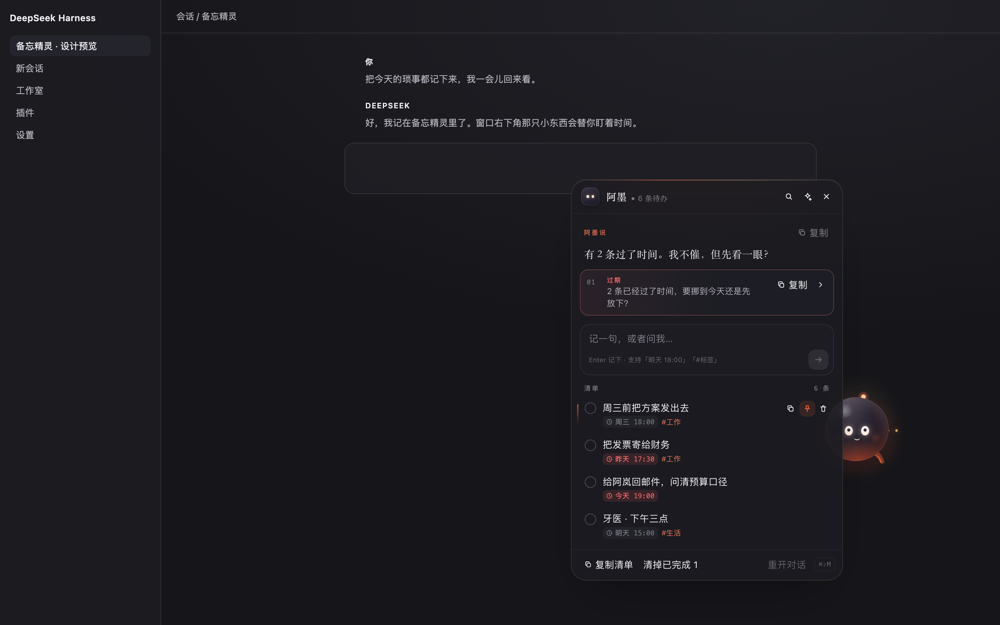

# 备忘精灵 · Memo Pet

一只住在 DSH 角落里的备忘宠物「阿墨」。说一句话它就记住；不叫它的时候缩成一个细小的边缘入口，鼠标扫过去才探出头来。

> 以 Awwwards / FWA 的完成度标准做的一只小东西：一个会呼吸的墨色生物、一张克制的备忘卡、一套只用 transform 和 opacity 的动效。



## 它能做什么

- **说一句就记下。** 「明天下午三点 牙医复查 #生活」→ 标题「牙医复查」、时间明天 15:00、标签「生活」。认「今天 / 明天 / 后天 / 下周三 / 周五前 / 3月2日 / 下午三点 / 晚上八点 / 3点半」这些说法，中文数字也认。
- **不叫它就藏起来。** 收起来时屏幕边缘只留一个 24px 的细条，上面是未完成条数；悬停它，阿墨和一句问候一起滑出来，点一下展开面板。
- **一只真的会动的宠物。** 弹簧跟随、挤压拉伸、眼神追着鼠标、随速度倾斜、天线与飘带滞后摆动、随机眨眼、闲置 32 秒打瞌睡、拖动后带惯性甩出去并贴边。全部走同一个 rAF，只写 `transform` 和 CSS 变量，不触发 React 重渲染。
- **意见可以复制。** 面板顶部的「意见带」每次给一条具体建议（过期 / 今天 / 搁太久 / 该收一收），按 `›` 换一条，点「复制」拿到可直接粘贴的清单；每条备忘、阿墨说的每句话也都能单独复制。
- **问它也行。** 「我今天先做什么？」这类问句会交给模型回答（阿墨会把当前清单一起带上）；陈述句则本地即时入库，不等模型、不花 token、断网也能用。
- **在普通对话里也能用。** 插件给所有 agent 注册了 `memo_pet` 工具，所以在任何会话里说「记一下……」都会进同一份清单。

## 怎么打开

| 方式 | 动作 |
| --- | --- |
| 边缘入口 | 鼠标移到屏幕右侧（或左侧）那条细竖条上，再点阿墨 |
| 快捷键 | `⌘⇧M` / `Ctrl+Shift+M` 开关面板 |
| 宠物 | 直接点阿墨；按住可以拖到任意位置，双击展开 |
| 收起 | 面板右上角 `×` 或 `Esc` |

面板里：回车记下，`Shift+回车` 换行；单击圆圈完成，双击标题改名；悬停一行右侧出现复制 / 钉住 / 删除；删除后可「撤销」。

## 复用了什么

| 宿主能力 | 用途 |
| --- | --- |
| `shell.overlay` 插槽 | 全窗悬浮层，浮在所有栏位之上、不受滚动容器影响 |
| `agents` / `sessions` | 「意见」之外的问答走一个专属会话，可恢复、带上下文 |
| `systemPrompt` / `tools` | 给所有 agent 注册 `memo_pet`，并在系统提示里写明路由 |
| `dsh-alias-*` 主题令牌 | 面板与文字跟随深/浅色，只用手写强调色 `#FF6B3D` |
| Typert Remote | 客户端与服务端一条 `memoPet/request` 通道 |

自己新写的只有三样：备忘的解析与建议（`src/pet.js`，纯函数、18 个单测）、宠物的动作引擎（`src/client/pet.jsx`）、以及面板的排版与微交互（`src/client/panel.jsx` + `src/styles.css`）。

## 数据在哪

`~/.dsh/memo-pet/state.json`，原子写入（临时文件 + rename），损坏时自动留档为 `state.json.broken-<时间>` 并重建。不写用户工作区。宠物位置、名字、安静模式也在这份文件里。

## 还没做到的

- 到点弹提醒（目前只做「过期 / 今天」的意见和角标，不主动弹窗）。
- 多设备同步 / 导入导出文件（只有「复制清单」）。
- 备忘的正文编辑（可以双击改标题，正文暂时只读）。
- 没配默认模型时只能记录、不能对话，面板会明说这一点。

## 开发

```bash
npm run build     # esbuild → dist/client.js（带 __ModuleLoader__ 包装）
npm run check     # 语法 + 产物契约
npm test          # 解析、建议、存储的纯函数测试
npm run preview   # 生成并起一个本地预览台（假宿主，不需要 DSH）
npm run shots     # 用无头 Chrome 截图到 docs/shots/
```

预览台（`preview/`）用真实的 `src/client.jsx` + 一个内存宿主跑起来，所以版式和交互可以在不重启 DSH 的情况下反复调：

```bash
npm run preview      # http://127.0.0.1:4173/index.html?mode=open&theme=dark
# mode: open | peek | closed | empty | after-add | settings   theme: dark | light
```

截图（`docs/shots/`，`npm run shots` 生成）：

| 状态 | 文件 |
| --- | --- |
| 展开 · 深色 | `open-dark.png` |
| 悬停探头 | `peek-dark.png` |
| 收起 · 只剩入口 | `closed-dark.png` |
| 展开 · 浅色 | `open-light.png` |
| 空清单 | `empty-dark.png` |
| 记完一条之后 | `after-add.png` |
| 窄屏 · 底部抽屉 | `mobile-open.png` |

MIT.
